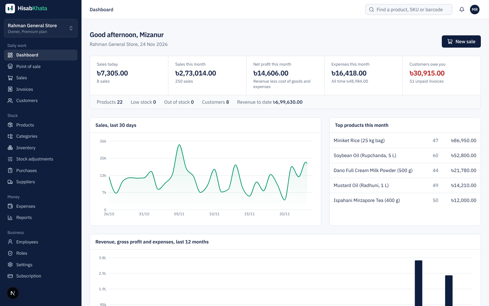
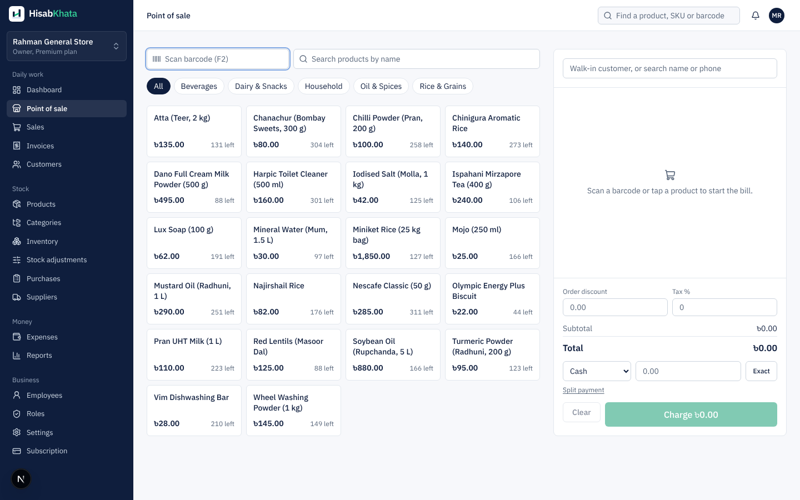
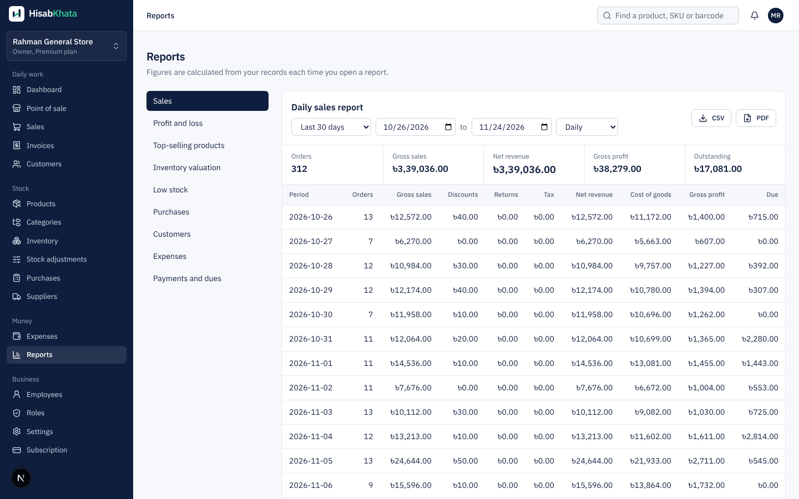
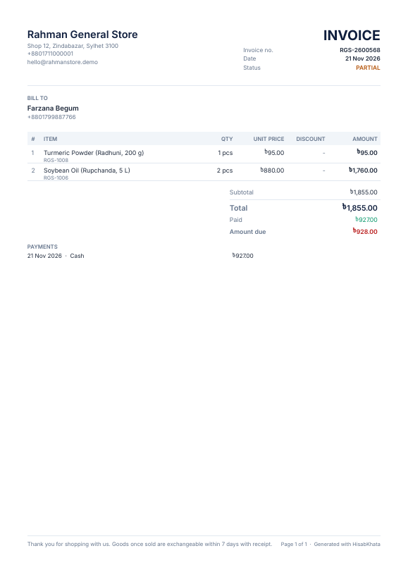
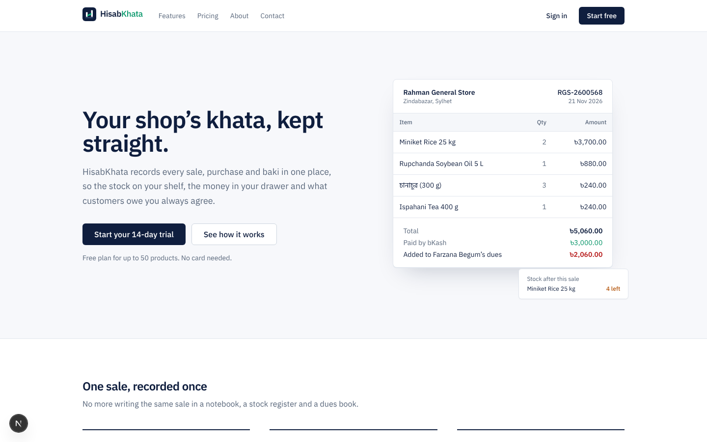
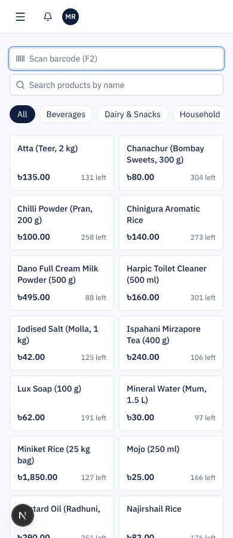

<p align="center">
  
</p>

<p align="center">Multi-tenant inventory, point of sale, invoicing and business management for shops and wholesalers in Bangladesh.</p>

---

HisabKhata replaces the shop's paper _khata_. Every sale, purchase, return and payment updates stock, money and customer dues in one database transaction, and every business on the platform is isolated from every other.

## Screenshots

| Dashboard                                    | Point of sale                    |
| -------------------------------------------- | -------------------------------- |
|  |  |

| Reports                                  | Invoice PDF                                  |
| ---------------------------------------- | -------------------------------------------- |
|  |  |

| Public site                                   | POS on a phone                                 |
| --------------------------------------------- | ---------------------------------------------- |
|  |  |

## Features

- **Multi-tenancy**: shared database and schema with `tenantId` on every tenant-owned row, tenant resolved from the signed token and re-checked against membership on every request, plus a Prisma extension that scopes queries as a second layer. A user can belong to several businesses and switch between them.
- **Auth**: registration with business onboarding, email verification, password reset, Argon2id hashing, short-lived JWT access tokens and rotating refresh tokens in HTTP-only cookies with replay detection, double-submit CSRF protection, login lockout, rate limits.
- **RBAC**: Owner, Manager, Cashier and Staff roles plus custom roles built from 29 granular permissions; the API checks permissions, not role names, and blocks privilege escalation. The platform super admin is a separate flag that tenant owners never get.
- **Inventory**: products with SKU, barcode, unit, prices, tax, images, categories, bulk actions, low and out-of-stock alerts, and an append-only stock ledger. Stock only changes through one service that writes a movement in the same transaction.
- **POS**: barcode scanning, search, category browsing, line and order discounts, tax, cash change, split payments (cash, card, bKash, Nagad, Rocket, bank), credit sales to customers, idempotent checkout, and concurrency-safe stock decrement (no overselling under parallel checkouts).
- **Sales after the fact**: receive due payments, partial or full returns that restock and settle dues first, cancellation with restock and refund.
- **Purchases and suppliers**: stock-in with landed cost, partial payments, supplier payables paid oldest-first, cancellation that reverses stock.
- **Customers**: profiles, purchase history, outstanding balance, payment allocation to the oldest invoices, downloadable statements. Bangladesh mobile numbers are validated and normalised; international numbers are accepted.
- **Invoices**: PDFKit invoices with logo, BIN, taka sign and Bangla product names, gap-free per-tenant numbering with a custom prefix, download or email (generated in a background job).
- **Expenses and reports**: expense categories, daily/weekly/monthly/annual sales, profit and loss, inventory valuation, low stock, top products, purchases, customers, expenses, payments and dues, all exportable as CSV or PDF, with consistent revenue, gross profit and net profit definitions.
- **Subscriptions**: Free, Basic and Premium plans (configurable), trial, product and user limits, feature gating, upgrade and downgrade, history, expiry reminders and automatic fallback to Free. Payments go through a provider abstraction (SSLCommerz and manual bank/mobile transfer included); a plan is activated only after verified confirmation, with signed and idempotent webhooks.
- **Background jobs**: BullMQ on Redis for email, invoice PDFs, expiry checks and low-stock digests, with retries, failed-job monitoring and de-duplicated email delivery. Runs inline when Redis is not configured.
- **Super admin panel**: platform overview, businesses (suspend or reactivate), users, plans, subscriptions and manual payment confirmation, analytics, audit logs, job monitor, email log and announcements.
- **Frontend**: Next.js App Router, Tailwind and shadcn-style components on Radix, TanStack Query, React Hook Form with the same Zod schemas as the API, light and dark themes, responsive down to phones.

## Technology

| Layer   | Stack                                                                                                                                       |
| ------- | ------------------------------------------------------------------------------------------------------------------------------------------- |
| API     | NestJS 11, TypeScript, Prisma 7 (`@prisma/adapter-pg`), PostgreSQL 16, Passport JWT, Zod, Swagger, BullMQ + Redis, Nodemailer, PDFKit, Pino |
| Web     | Next.js 15 (App Router), React 19, Tailwind CSS, Radix UI, TanStack Query, React Hook Form, Zod, Recharts, Lucide                           |
| Shared  | `@hisabkhata/shared`: permissions catalogue, Zod schemas, money and phone helpers used by both apps                                         |
| Tooling | pnpm workspaces, Jest + Supertest, ESLint, Prettier, Husky, Docker Compose, GitHub Actions, Mailpit                                         |
| Hosting | Vercel (web), Render (API), Neon (Postgres), Upstash (Redis), Cloudinary (files), Brevo or Resend (email)                                   |

## Architecture

```
Browser ──▶ Next.js (Vercel) ──/api/* rewrite──▶ NestJS API (Render) ──▶ PostgreSQL (Neon)
                                                     │                 └─▶ Redis / BullMQ (Upstash)
                                                     ├─▶ Cloudinary (images, private delivery)
                                                     └─▶ SMTP (Brevo / Resend / Mailpit)
```

The browser only talks to the web origin; Next.js proxies `/api/*` to the API. Auth cookies are therefore first-party and `SameSite=Lax`. See [docs/architecture.md](docs/architecture.md).

## Folder structure

```
hisabkhata/
  apps/
    api/            NestJS API: src/modules/*, prisma/ (schema, migrations, seed), test/ (integration tests)
    web/            Next.js app: src/app/(marketing|auth|app), super-admin/, components/, hooks/
  packages/
    shared/         Zod schemas, permissions, money/phone helpers
    config/         Shared TypeScript config
  infrastructure/
    docker/         Dockerfiles and Postgres init script
  docs/             Architecture, schema, API, multi-tenancy, auth, deployment, development guide, brand
  .github/workflows CI
  docker-compose.yml, render.yaml, pnpm-workspace.yaml
```

## Getting started

Requirements: Node.js 22, pnpm 10, and either Docker or local PostgreSQL 16 and Redis 7.

```bash
git clone https://github.com/thowfique041/hisabkhata-saas.git
cd hisabkhata-saas
pnpm install                                     # also builds @hisabkhata/shared and generates the Prisma client
docker compose up -d postgres redis mailpit      # or use your own Postgres/Redis
cp apps/api/.env.example apps/api/.env           # then set JWT_ACCESS_SECRET (openssl rand -base64 48)
cp apps/web/.env.example apps/web/.env.local
pnpm db:deploy                                   # apply migrations
pnpm db:seed                                     # plans, super admin and demo businesses
pnpm dev                                         # API on :4000, web on :3000
```

Open http://localhost:3000. Mail sent locally appears in Mailpit at http://localhost:8025.

### Demo accounts (from the seed)

| Account                                | Email                       | Password     |
| -------------------------------------- | --------------------------- | ------------ |
| Platform super admin                   | `admin@hisabkhata.local`    | `Admin12345` |
| Owner, Rahman General Store            | `owner@rahmanstore.demo`    | `Demo12345`  |
| Manager                                | `manager@rahmanstore.demo`  | `Demo12345`  |
| Cashier                                | `cashier@rahmanstore.demo`  | `Demo12345`  |
| Owner, Shapla Pharmacy (second tenant) | `owner@shaplapharmacy.demo` | `Demo12345`  |

Change or disable these before any public deployment (`SEED_DEMO_DATA=false`, and set `SEED_SUPERADMIN_*`).

### Environment

All variables are validated at start-up (`apps/api/src/config/env.ts`); the API refuses to start with a missing or weak secret. The full list with explanations is in [`apps/api/.env.example`](apps/api/.env.example) and the production checklist in [docs/deployment.md](docs/deployment.md).

### Database

| Task                                             | Command                                        |
| ------------------------------------------------ | ---------------------------------------------- |
| Create a migration after editing `schema.prisma` | `pnpm --filter @hisabkhata/api prisma:migrate` |
| Apply migrations                                 | `pnpm db:deploy`                               |
| Seed                                             | `pnpm db:seed`                                 |
| Reset local database and reseed                  | `apps/api/scripts/reset-db.sh`                 |

If your network blocks Prisma's engine download host, `node apps/api/scripts/prisma-wasm.mjs diff <name>` and `... deploy` do the same using Prisma's official WebAssembly schema engine.

## Testing

```bash
pnpm test        # 9 unit + 60 integration tests against a real PostgreSQL database (hisabkhata_test)
```

The integration suite covers registration, login, lockout, CSRF, refresh-token rotation and replay, password reset, email verification, tenant isolation (reads, writes, invoices, files, tenant switching, body-supplied `tenantId`), role permissions and privilege escalation, super-admin gating, product CRUD, stock adjustments, purchases, sales, concurrent checkouts, idempotency, refunds, cancellations, invoice PDFs and emails, reports, plan limits, payment confirmation and scheduled jobs. Set `TEST_DATABASE_URL` to point at another database.

## API documentation

Swagger UI is served at `http://localhost:4000/api/docs`. For API clients, get a bearer token from `POST /api/auth/token`. See [docs/api-documentation.md](docs/api-documentation.md).

## Docker

```bash
docker compose up -d postgres redis mailpit        # infrastructure only
docker compose --profile app up --build            # API and web in containers too
```

## Deployment

Web on Vercel, API on Render, Postgres on Neon, Redis on Upstash, images on Cloudinary, email via Brevo or Resend. Step-by-step instructions, free-tier limits and troubleshooting: [docs/deployment.md](docs/deployment.md).

## Security

- Tenant isolation enforced in the guard, in every service query, and by a Prisma scoping extension; verified by automated cross-tenant tests.
- Argon2id passwords, hashed refresh tokens with rotation and family revocation, hashed one-time tokens for email verification and resets.
- HTTP-only, `Secure` (production), `SameSite=Lax` cookies; double-submit CSRF token for cookie-authenticated writes.
- Helmet security headers, strict CORS allow-list, request-size limits, rate limits on auth endpoints, account lockout.
- Zod validation on every input; Prisma parameterised queries; CSV formula-injection protection; upload type detection by magic bytes and size limits; files served only to their own tenant.
- Errors never leak stack traces or database details; logs redact cookies, authorization headers, passwords and tokens.
- Audit log for authentication, permission, stock, sales, billing and admin actions.

More in [docs/authentication.md](docs/authentication.md) and [docs/multi-tenancy.md](docs/multi-tenancy.md).

## Documentation

- [Architecture](docs/architecture.md)
- [Database schema](docs/database-schema.md)
- [API documentation](docs/api-documentation.md)
- [Multi-tenancy](docs/multi-tenancy.md)
- [Authentication and authorization](docs/authentication.md)
- [Deployment](docs/deployment.md)
- [Development guide](docs/development-guide.md)
- [Brand guidelines](docs/brand/README.md)
